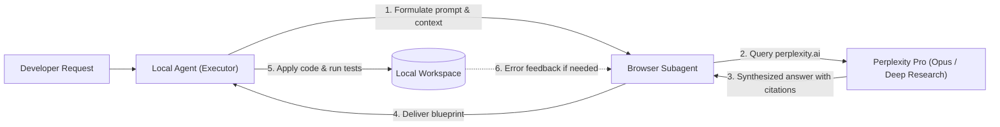

# Perplexity Web Mentor Skill

An intelligent agent skill and workflow protocol that connects an authenticated web session of Perplexity Pro (leveraging models such as Claude Opus, Claude Sonnet, and Deep Research) with your local agent execution environment.

---

## Overview

Modern engineering projects often require cutting-edge documentation, real-time web research, and advanced cross-model reasoning.

The **Perplexity Web Mentor Skill** integrates Perplexity Pro's live web grounding and advanced model reasoning directly into your local coding workflow:
- **The Mentor (Perplexity Pro Web)**: Serves as the Real-Time Researcher and System Architect. It accesses live web sources, latest API documentation, and high-tier reasoning engines (e.g., Claude Opus) to synthesize technical solutions.
- **The Executor (Local Agent)**: Acts as the Local Implementation Engineer. It collects repository context, interacts with Perplexity via an embedded browser subagent, extracts concrete code blueprints, and executes file updates and test suites locally.



---

## Key Capabilities

- **Real-Time Web Grounding**: Accesses current framework documentations, recent breaking changes, and external community solutions.
- **Advanced Model Reasoning**: Leverages high-tier models such as Claude Opus and Deep Research available in your Perplexity Pro subscription.
- **Session Persistence**: Maintains your authenticated login in the local browser profile across sessions.
- **Closed-Loop Verification**: Automatically executes tests locally and feeds error traces back to Perplexity if adjustments are required.

---

## Directory Structure

```text
perplexity-web-mentor-skill/
├── .agents/
│   └── skills/
│       └── perplexity-web-mentor/
│           └── SKILL.md         # Skill definition
├── perplexity-web-mentor/
│   └── SKILL.md                 # Standalone skill
├── README.md                    # English documentation
└── .gitignore                   # Ignore patterns
```

---

## Getting Started

### 1. Installation

#### As a Workspace Skill
Place the skill into your project's `.agents/skills` folder:

```bash
mkdir -p .agents/skills/perplexity-web-mentor
cp perplexity-web-mentor/SKILL.md .agents/skills/perplexity-web-mentor/SKILL.md
```

### 2. One-Time Browser Authentication

1. Instruct your agent to navigate to Perplexity:
   > "Open https://www.perplexity.ai in the browser."
2. Complete your one-time sign-in on the browser view with your Perplexity Pro account.
3. The session cookies are saved locally and persist across subsequent agent sessions.

### 3. Usage & Examples

Once logged in, trigger the skill anytime:

- **Up-to-Date API Research**:
  > "Use Perplexity to find the latest migration guide for Next.js 15 Server Actions and apply it to our auth handler."
- **Claude Opus Architectural Review**:
  > "Ask Perplexity using Claude Opus to review our concurrency design and implement the thread-safe queue locally."

---

## Security & Boundary Notice

- Authentication credentials are entered directly by the user in the browser pane; secrets are never stored in plain text or committed to repositories.
- All file edits and command executions adhere strictly to local sandbox security boundaries.
