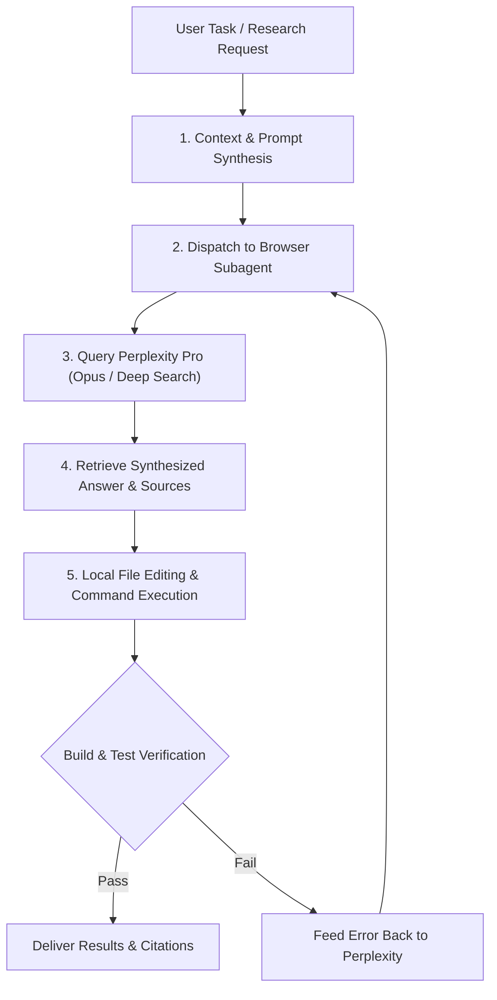

# Perplexity Web Mentor Skill

This skill implements an **Augmented Dual-Agent Research & Execution Architecture**:
- **Mentor & Researcher (Web Perplexity Pro)**: Harnesses an authenticated session on `https://www.perplexity.ai` (utilizing high-tier models such as Claude Opus / Sonnet, Pro Search, and Deep Research) to perform live documentation lookups, cross-library feasibility analysis, and architectural design.
- **Executor (Local Agent)**: Gathers local repository context, orchestrates queries through the browser subagent, extracts synthesized technical blueprints, and implements code and tests on the local machine.

---

## Workflow Procedure

### Step 1: Context & Prompt Synthesis
1. Identify target modules, dependencies, and external APIs in the local repository.
2. Formulate a targeted technical prompt for Perplexity:
   - State the technical goal, framework versions, and language runtime.
   - Request up-to-date official documentation citations and concrete code implementations.
   - Instruct the model to provide step-by-step code blocks tailored for automated local execution.

### Step 2: Browser Subagent Engagement
1. Invoke or message the `browser` subagent.
2. Navigate to `https://www.perplexity.ai`.
3. **Project Categorization (Anti-Clutter)**: Locate or create a dedicated **Project (项目)** in Perplexity's left sidebar matching the local workspace (e.g., `Gemini Antigravity`). Execute all queries and Deep Research within this Project space instead of polluting the root chat list.
4. Confirm active Pro session and model selection (e.g., Claude Sonnet 5.5, Kimi Thinking, or Best model).
5. **Strict Constraint - No 'Computer' Mode**: Do NOT click or toggle the 'Computer' mode button under any circumstances. Ensure only standard 'Search' (搜索) or standard model generation is used, keeping 'Computer' completely disabled.
6. **Deep Research Encouraged**: For multi-source technical investigations, ecosystem comparisons, or difficult bug tracing, actively enable and encourage Perplexity's **Deep Research / 研究模式** to harvest comprehensive citations and verified code.

### Step 3: Query Submission & Await Results
1. Enter the query into Perplexity's search textarea (`textbox "Ask anything..."` / `textbox "搜索任何内容..."`).
2. Trigger the search and allow the Pro Search / Deep Research cycle to complete.
3. Monitor completion indicators (ensure answer generation, citations, and source links are fully rendered).

### Step 4: Extraction & Analysis
1. Extract the synthesized response text, markdown code blocks, and key source references.
2. Review proposed dependencies, configuration patterns, and code diffs against local project constraints.

### Step 5: Local Execution
1. Apply the recommended modifications using `write_file` and `edit_file`.
2. Run installation and test commands via `run_command` in standard sandbox mode.

### Step 6: Closed-Loop Verification
1. Run local test suites or validation scripts.
2. If tests pass, deliver the result along with key technical citations from Perplexity.
3. If errors occur, feed the runtime logs back into the Perplexity thread to obtain updated fixes.

---

## Mentor Selection Guideline
- **Use Gemini Web Mentor**: Complex algorithmic logic, long-context code refactoring, and Google ecosystem projects.
- **Use Perplexity Web Mentor**: Cutting-edge third-party libraries, live documentation lookups, deep web research, and Claude Opus / multi-model reasoning.
- **Autonomous Quota Fallback (Pre-Authorized)**: If Claude Sonnet 5.5 or Deep Research quota on Perplexity is exhausted, immediately and autonomously switch to Kimi K3 (Thinking), GPT-6.2 Sol, or Web Gemini Advanced without prompting the user.
